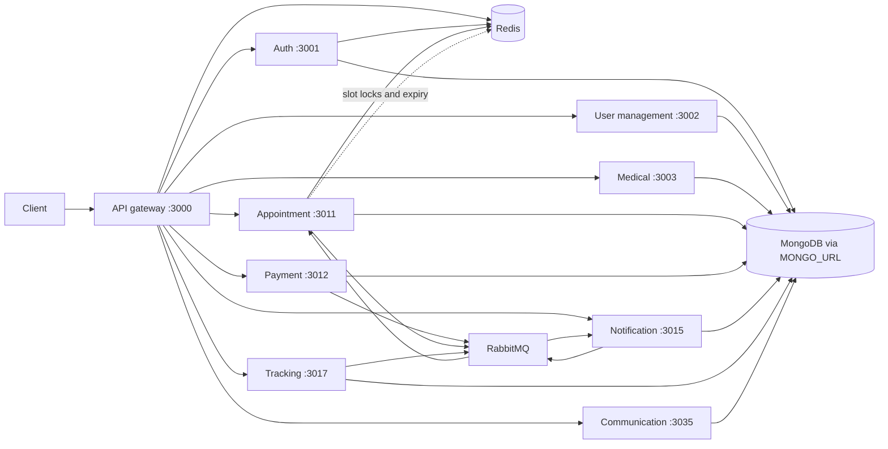

# SecondProject — Engineering Guide

## Executive overview

SecondProject is a healthcare-oriented backend organized as an API gateway and eight independently packaged domain services. HTTP handles synchronous requests, while MongoDB, Redis, and RabbitMQ support persistence, short-lived coordination, and asynchronous workflows; Docker Compose and path-scoped GitHub Actions provide the repository's local and delivery workflows.

## At a glance

| Concern | Repository-backed view |
|---|---|
| Architecture | TypeScript/Node.js services, a central API gateway, and service-owned domain code |
| HTTP entry point | API gateway on port 3000 |
| Main integration styles | HTTP service clients, RabbitMQ events, and Redis-backed coordination |
| Persistence | Mongoose models in domain services; services read their MongoDB connection configuration through MONGO_URL |
| Local orchestration | docker-compose.yml |
| CI/CD | GitHub Actions workflows scoped to service paths on pushes to main |

## Overview and architecture

The gateway is the client-facing HTTP entry point and is configured with service URLs for the domain APIs. Domain services own their application logic and data models. The codebase uses HTTP for request/response work, RabbitMQ for selected cross-service events, and Redis for caching, locks, and expiry handling where implemented.



MongoDB is shown as a configured connection rather than a Compose-managed container: the Compose service inventory includes RabbitMQ and Redis, but no MongoDB service. Database endpoints therefore come from service configuration and deployment environment.

## Services

Ports below are the host/container mappings declared in docker-compose.yml. Responsibilities are summarized from the service names, routes, controllers, and models present in the repository.

| Path | Responsibility | Port |
|---|---|---:|
| api-gateway/ | HTTP entry point, routing, authentication middleware, and service URL configuration | 3000 |
| auth-service/ | User/doctor identity, authentication, and token-related flows | 3001 |
| user-management-service/ | User and doctor profiles and related user-management records | 3002 |
| medical-service/ | Medical prescriptions, user profiles, and pregnancy RAG data | 3003 |
| appointment-service/ | Appointments, doctor slots, payment-event handling, and Redis slot expiry | 3011 |
| payment-service/ | Payment orders, Razorpay integration, and refund handling | 3012 |
| notification-service/ | Appointment-related notification event handling | 3015 |
| tracking-service/ | User symptoms and tracking records | 3017 |
| communication-service/ | Chat threads and chat messages | 3035 |

## Key flows

### HTTP authentication

The gateway's withAuth middleware permits configured public prefixes, otherwise requires an Authorization header using the Bearer scheme and verifies the token with the configured JWT secret. The verified claims include an id and role; service code also contains role middleware/decorators in relevant domain services. The reviewed code confirms these checks, but does not establish one uniform rule for forwarding token claims to every downstream service; confirm each endpoint's middleware and client behavior before relying on propagation.

### Appointment and payment events

The following rows are included only where the repository source confirms the event, publisher/consumer relationship, and purpose.

| Event | Publisher | Consumer | Purpose |
|---|---|---|---|
| payment.success | Payment service | Appointment service; appointment.payment.success queue | Processes payment success and publishes appointment.confirmed. |
| payment.refunded | Payment service | Appointment service; appointment.payment.success queue | Processes the refund acknowledgement and marks the appointment REFUNDED. |
| appointment.confirmed | Appointment service | Notification service; notifications.appointments.confirmed queue | Triggers appointment notification handling. |
| appointment.cancelled | Appointment service | Payment service refund consumer | Starts the cancellation-related payment refund flow. |

The appointment RabbitMQ configuration declares a payment-success queue with retry and dead-letter topology. The payment consumer has a maximum of three processing retries; the retry queue uses a 10-second TTL before retry. Appointment slot reservation also uses Redis locking and a Redis key-expiry subscriber to react to expired slot keys.

### Data ownership

Ownership below reflects model declarations present in the repository; it does not claim that these are the only production collections.

| Service | Models confirmed in source |
|---|---|
| Auth | User, Doctor |
| User management | DoctorProfile, Fetus, Symptoms |
| Medical | MedicalPrescription, PregnancyRagChunk, UserProfile |
| Appointment | Appointment, DoctorSlot |
| Payment | PaymentOrder |
| Tracking | Symptoms, UserSymptoms |
| Communication | ChatThread, ChatMessage |
| Notification | No notification collection model was confirmed in the reviewed model files |

## Technology stack

| Area | Technologies evidenced in manifests/configuration |
|---|---|
| Language and runtime | TypeScript, Node.js, ECMAScript modules |
| HTTP frameworks | Express across the gateway and several services; NestJS test/application structure in communication and notification services |
| Persistence | MongoDB with Mongoose models |
| Messaging and coordination | RabbitMQ via amqplib; Redis clients for cache/locks/expiry workflows |
| Dependency and validation patterns | Inversify dependency injection; Zod utilities in service code |
| Payments and AI | Razorpay; Google Gemini configuration in the medical service |
| Files and media | AWS S3 configuration in auth and user management; Cloudinary configuration in user management |
| Operations | Docker and Docker Compose; GitHub Actions; Prometheus metrics, Loki logging, and Grafana/Alertmanager services in Compose |

## Local development

1. Install Docker Engine and the Docker Compose plugin.
2. Create a .env file for each service referenced by docker-compose.yml: api-gateway/.env, auth-service/.env, user-management-service/.env, medical-service/.env, appointment-service/.env, payment-service/.env, notification-service/.env, tracking-service/.env, and communication-service/.env.
3. Populate required names from the corresponding service configuration. Several services call a required-variable helper and fail startup when required configuration is missing. Keep credentials in local environment files or a secret manager; do not commit them.
4. Start the composed environment:

```sh
docker compose up --build
```

The Compose configuration exposes the service and infrastructure ports listed in its service definitions. It configures RabbitMQ and Redis for the composed environment. MongoDB is not a Compose service in the reviewed file, so MONGO_URL must point to a separately available database. To work on one service, use its package scripts: build runs tsc, start runs the compiled dist/server.js, dev runs TypeScript watch with nodemon, and lint runs ESLint with --fix. Check the individual package.json for service-specific scripts.

## CI/CD

The repository contains separate Docker build/push and deploy workflows for the gateway and each of the eight services. The workflows are triggered by pushes to main scoped to the relevant service directory and workflow file. Docker workflows build and publish service images tagged latest and with the Git commit SHA. Deploy workflows use SSH and K3s-related commands to deploy to the configured host. Credentials are referenced through GitHub Actions secrets and are not documented here.

## Known gaps and roadmap

- 7 of 9 service package manifests use a placeholder test command that exits with “no test specified”; replace these with service-level unit and integration suites.
- No OpenAPI, AsyncAPI, GraphQL schema, or protobuf contract files appear in the repository inventory; define and version HTTP and event contracts to reduce cross-service drift.
- Consolidate or share the repeated per-service image and deployment workflow logic while retaining path-scoped builds and service-specific deployment settings.
- Add integration coverage for high-impact cross-service workflows, especially payment success/refund, appointment confirmation/cancellation, and Redis slot expiry; current checked-in end-to-end tests are limited to basic application-root smoke tests in communication and notification.

## Notes

- The environment-variable table records variable names only, not values. Compose references per-service .env files; configuration templates were not confirmed in the reviewed repository inventory.
- Service/model ownership and workflow behavior are described from checked-in code and configuration, not from a live production deployment.
- Tracking configuration uses the spelling APPOINMENT_SERVICE_URL. Verify this against the intended appointment-service URL before changing it; no value is included here.
